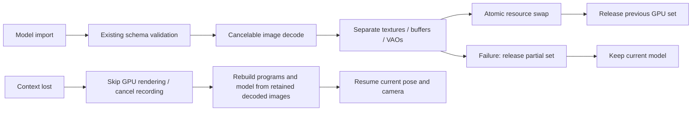

# Project Heartbeat — Phase 1

Work branch: `feature/project-heartbeat-phase1`.

## Inspected baseline

This checkout already contained uncommitted roadmap changes before Heartbeat.
They remain in place. In particular, the actual model format is **v3**, with
v1/v2 acceptance; this phase introduces no schema changes.

The application has no build step or core runtime packages. Maker (`src/app.js`)
and Viewer (`src/viewer.js`) use the shared WebGL2 renderer, scene hierarchy,
parameter evaluation and motion systems. The current renderer includes isolated
group compositing, blend modes and stencil clipping. Projects use JSON/ZIP
import and IndexedDB storage. The Viewer also has text/timed audio lip-sync,
optional face tracking, local controls, and fixed-canvas WebM recording.

Baseline executed on this checkout:

- Node v25.9.0: `npm run check` — syntax checks and **104 tests passed**.
- Python 3.10.9: server unit tests — **8 passed**.
- Chromium: `tests/browser_record.py` — passed, recording 940×836 VP9 with
  microphone audio, composited background and mid-recording resize.
- Chromium initially could not launch inside the macOS sandbox; the browser
  check passed after permission to run outside it.

These are functional baselines, not performance measurements or reviewed visual
regression baselines.

## Prioritized findings

| Priority | Finding | Files | Work |
| --- | --- | --- | --- |
| Critical | Old resources were deleted before GPU replacement finished; null allocations and GL errors went unchecked | `src/renderer.js` | Phase 1 |
| Critical | Failed shader/program and compositing surface creation leaked partial allocations | `src/renderer.js` | Phase 1 |
| Critical | No context-loss recovery or renderer disposal | `src/renderer.js`, `src/app.js`, `src/viewer.js` | Phase 1 |
| Critical | Microphone stream, AudioContext and analysis loop had no shared owner or disable/device-switch path | `src/viewer.js` | Phase 1 |
| High | Recording interruption could strand capture resources or an unresolved stop; borrowed microphone tracks must survive cleanup | `src/recorder.js`, `src/viewer.js` | Phase 1 lifecycle prerequisite; recording settings remain Phase 3 |
| Critical | Model validation lacks global allocation limits and fully defensive handling of malformed nested data | `src/model.js`, `src/project-file.js`, `src/openraster.js` | Phase 2 |
| High | No checked-in CI workflow or reviewed deterministic screenshot baselines | `.github/workflows/`, `tests/`, `src/benchmark.js` | Phase 4 |
| High | Existing local controls and streaming need audit against the requested versioned protocol and opt-in requirements | `src/control-api.js`, `serve.py`, `src/viewer.js` | Phase 5 |
| Medium | Existing rigging and benchmark additions need held-out, permission-cleared quality evaluation | `src/auto-rigger.js`, `src/eyelid-rig.js`, `src/benchmark-fixtures.js` | Phases 6–8 |

## Resource ownership and recovery

`KokoroRenderer.setModel(model, { signal })` validates and decodes before GPU
allocation. Newer loads supersede pending decodes; an AbortSignal can also cancel
one. Allocation ownership is recorded immediately, including partially built
layers. Failed uploads release only the staged set. Shared image sources use one
texture per resource set. During replacement, old and new resources coexist, so
peak GPU memory can be larger than steady-state memory.

Context loss prevents the default browser behavior, invalidates GPU handles,
cancels pending loads and skips rendering. CPU model, decoded images, parameters
and camera remain available. On restoration, programs and all model resources
are rebuilt; compositing surfaces are recreated on the next frame. The existing
motion engine continues to own animation state. Recovery errors leave rendering
paused and emit `recoveryerror`; `renderer.restore()` can retry, and the UI offers
reload guidance. `dispose()` cancels decoding, removes context listeners and
releases programs, buffers, VAOs, textures and compositing surfaces.

Renderer events are `contextlost`, `contextrestored`, and `recoveryerror` (whose
`detail` is an Error). A lost context cancels the current recording and clearly
reports that the take was discarded. It does not stop microphone lip-sync.

## Microphone and recording

Microphone access only begins after **Enable microphone lip sync**. It requires
a supported browser on localhost or HTTPS. The button becomes **Disable
microphone**, or **Cancel microphone request** while permission is pending.
Input names and selection become available after permission where supported.
Changing inputs releases the old stream and audio graph before starting the new
one. A denied permission produces instructions for the browser's site settings.

`src/microphone.js` owns the stream, AudioContext, source/analyser nodes, one
analysis RAF, device-change listener and optional Permissions API listener.
Disable, unplug, permission revocation, pending-request cancellation and page
exit all stop owned tracks and disconnect/close audio resources. A late permission
grant after cancellation is immediately released. Stopping a recording only
stops the capture's video tracks; microphone and timed-audio tracks are borrowed.

Recording retains its fixed-resolution compositing canvas. This phase adds
start guards, cancellation, initialization/error cleanup and a bounded stop wait.
Resolution/FPS/bitrate controls and transparent-video support are later work.

## Final Phase 1 verification

Executed on the working tree on 2026-10-14:

| Check | Result |
| --- | --- |
| `npm run check` | Passed: JavaScript syntax checks and 135 Node tests (104 existing + 31 new lifecycle tests) |
| `python3 -m unittest discover -s tests -p 'test_*server.py'` | Passed: 8 tests |
| `python3 tests/browser_lifecycle.py` | Passed in Chromium: Maker/Viewer context recovery, identical before/after fixture pixels, v1/v2 fixture loading, input switching, microphone disable/pagehide cleanup, recording interruption and subsequent recording |
| `python3 tests/browser_record.py` | Passed in Chromium: VP9, microphone audio, backdrop, fixed dimensions during resize |
| `python3 tests/browser_rig.py` | Passed in Chromium: export/import, gaze, placement/cancel; no page errors |
| `git diff --check` | Passed |

The 31 new Node tests inject null allocations, thrown uploads and WebGL error
flags; count live mock GPU handles across 100 replacements; cover shader and
surface failures; exercise cancelled/superseded loads and repeated recovery;
and test microphone races and recorder cleanup/error/timeout paths.

The initial new browser harness had a Playwright keyword-argument error, a Maker
startup/status race, and an unbounded wait when requesting restoration too early.
The corrected harness waits for Maker startup, lets the loss event finish before
requesting restoration, and bounds recovery and total runtime. The final run
passed; an older stalled run was stopped explicitly.

### Remaining scope and limits

- Phase 1 is complete for the tested checkout. Phases 2–8, including stronger
  import budgets, CI, recording settings, protocol changes and reviewed visual
  baselines, remain separate work. Existing roadmap additions are not claimed
  as Heartbeat deliverables or as fully audited implementations of those phases.
- Real-browser verification used Chromium and synthetic microphone inputs.
  Firefox/Safari, physical input hot-unplug, actual driver resets, permission UI
  interactions and OBS have not been verified here. Permission revocation and
  unplug are covered by deterministic controller tests.
- Recovery requires the browser to restore its context. A failed rebuild reports
  an error and keeps the CPU model; it cannot manufacture an available GPU.
- Resource-count assertions use an instrumented WebGL mock. They establish
  ownership/cleanup behavior, not a measured long-running GPU/heap benchmark.
- Retaining decoded images and temporarily holding both resource sets increases
  peak memory. Model-wide decoded-image and allocation budgets belong to Phase 2.
- Recordings interrupted by context loss or encoder failure are deliberately
  discarded with feedback. Partial-file salvage and cross-browser suspension
  handling still need the Phase 3 work.
- No animation algorithms, model schema, bundled artwork or weights were changed.
  Existing uncommitted changes remain intact. This phase is left uncommitted to
  avoid mixing that earlier work into new commits; a session-only patch is
  available in the final handoff.
